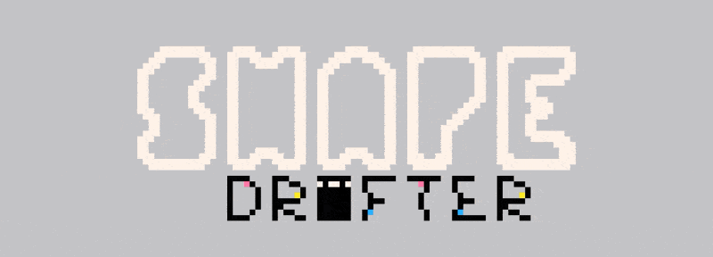

You can play Shapedrifter in your browser.

<iframe
  src="/pico-8/shapedrifter/shapedrifter.html"
  title="Play Shapedrifter, a PICO-8 game"
  class="bloob-embed"
  data-no-responsive-wrapper
  allowfullscreen
></iframe>

Or download the Shapedrifter cartridge to play on your preferred PICO-8 emulator device (the Miyoo Mini is pretty great).

# Title screen

What I like about the title screen is the core idea. That the drifter (that's you, the player character) sits as the letter i in drifter. It has multiple meanings, and a fun nod to interactive, or kinetic, type.

I like ideas that are super playful, and I dunno, this idea is simple, and I think the effect of that is fun. When you find something that's both easy and fun, with depth, I think you should chase that idea until you have something tangible from it.

Oh, and also, the drifter is the menu selector. Over time that might get annoying, maybe not, but I love mini games so I thought: why not make the menu itself into a mini game? I couldn't come up with arguments for why not, so I played around with how that should feel until it felt good. It's also a mini puzzle for you, the player, *How do I start the game?*, and when the solution reveals itself, maybe you like that. That's a chance I wanted to take.

# Bubble Drive

So Bubble Drive is one of three game modes in Shapedrifter. There's also Free Drive, and Shape Drive.

In Bubble Drive, you manuever the drifter into position and boop the falling bubbles back up into the air so they don't pop on the bottom spikes. You get points for each bubble that you boop back up in the air. That's really the whole game mode.

I had fun implementing the visuals, and figuring out the mechanics, and how the gameplay should present itself. Such as the marker when a bubble is off screen, and the tiny screen shake and stagger when the drifter knocks a bubble back up in the air.

# Changelog

- v0: Game published
- v1: Tweaked Bubble Drive
- v2: Changed open menu button, tweaked drift handling and draw order.
- v3: Seagulls now draw on top of the player. Poor seagulls in previous version! I can confirm that no seagulls have been harmed in the production and playing of this game though. It's all digital. Phew!
- v4: Removed engine rev up sound, it got annoying. Changed draw order so trees draw over drifter in free drive and shape drive. Adjusted drift on track, made it less punishing when going fast fast.
- v5: Draw bubbles and bubble life over other world details.
