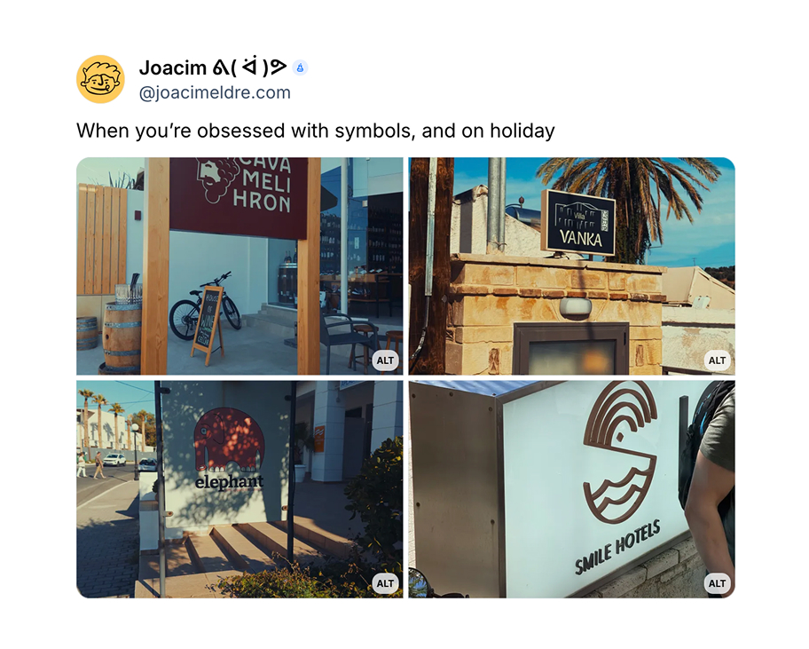

I think that designing a logo for yourself, perhaps more so if you identify as a designer, is one of the most daunting tasks there is.

It's a lot trickier than making something for someone else.

Heck, to make anything is tough, because of all the small decisions and details that you do along the way.

That this logo now exists is something that I cherish. I can always come back to it and refine later. No one has *the best thing* ever, when before the thing there was nothing.

And since I'm writing about logo design and really enjoy creating them, let me tell you about what I personally think makes a logo good.

Balance.

Asymmetry and variation.

More signal than noise.

And seeing the logo doesn't make you want to flip a table or run outside and scream. In other words, seeing the logo makes you not frustrated. This is the most difficult to get right, because people and their taste vary.

That's it. Doesn't sound hard, but often is.
